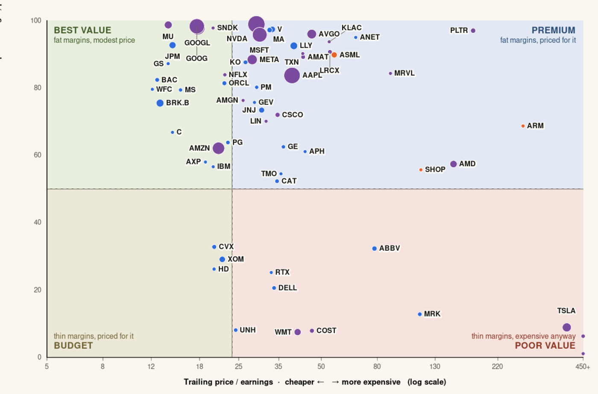
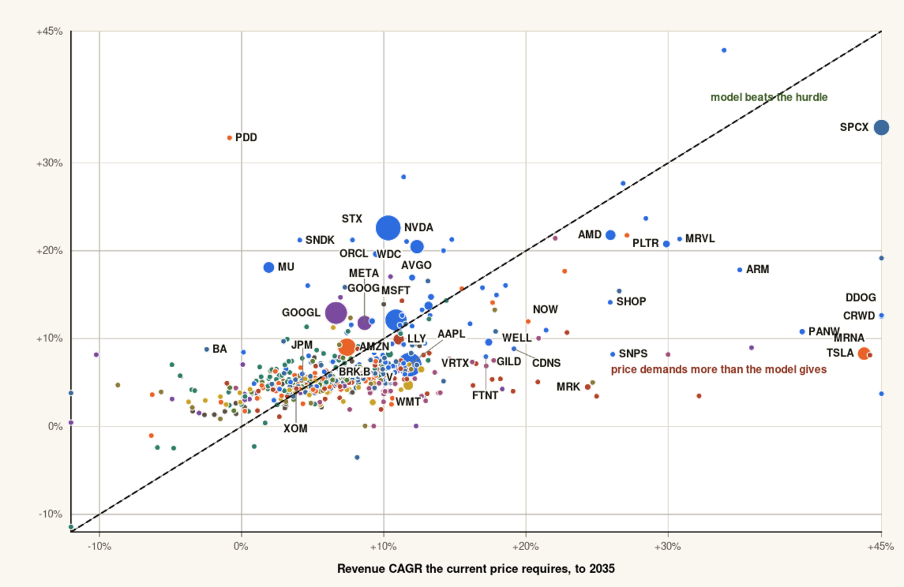

# What you pay vs. what you get

A 14-slide interactive map of the **S&P 500 and Nasdaq-100** — 516 listings — plotting what the
market charges for a dollar of profit against how profitable the underlying business actually is,
then projecting revenue to **2030 and 2035** and asking which companies look cheap against that
future.

Modelled on the cost-vs-livability quadrant charts you see for cities: cheap isn't good if the thing
you're buying is mediocre, and expensive can be fine if what you get is excellent.

Data as of **12 October 2026**. One self-contained HTML file, no build step needed to view it, no
external network requests at runtime.



---

## Quick start

```bash
open index.html          # macOS   (or: xdg-open index.html / just double-click it)
```

Arrow keys or the on-screen buttons move through the slides. Hover any dot for a full breakdown.
On a narrow screen the charts scroll sideways.

To rebuild from the raw data:

```bash
make            # prep -> model -> build, writes index.html
make test       # runs the chart geometry checks (needs node)
```

Python 3 standard library only. No pip install, no package.json, no network access.

---

## What's in the deck

**Slides 1–8 — measured.** Today's snapshot.

| Slide | What it shows |
|---|---|
| 1 | How to read the chart |
| 2 | All 487 companies with usable earnings: trailing P/E (log) against net-margin percentile |
| 3 | The 60 largest, individually labelled |
| 4 | The same question asked *inside each sector*, so banks aren't compared to grocers |
| 5 | Eleven sector panels on identical axes |
| 6 | Price against the past five years of annualised total return |
| 7 | Four-corner leaderboards and extremes |
| 8 | Method, and four ways the chart will mislead you |

**Slides 9–14 — modelled.** Projections to 2030 and 2035.

| Slide | What it shows |
|---|---|
| 9 | Exactly where data stops and assumption starts |
| 10 | Revenue today against modelled revenue in 2035, log-log |
| 11 | Implied annual return to 2035 against today's multiple |
| 12 | The inversion: growth the price *requires* vs. growth the model *delivers* |
| 13 | Bear/base/bull spread for the 34 largest — how much of the answer is the assumption |
| 14 | Cheapest and dearest against 2035, with assumption-sensitivity flags |

---

## Methodology

### The two axes on slides 1–8

**Horizontal — the price.** Trailing twelve-month price-to-earnings, log scale, because the range
runs from 2.7× to roughly 6,000×. Trailing, not forward: no analyst estimates involved, which keeps
the whole snapshot from one source but means a single bad quarter can dominate a company's position.

**Vertical — the quality.** Net profit margin, expressed as a percentile against the other 486
companies. Net income is recovered *exactly* from the two things the quote page gives:

```
P/E = price / EPS        =>        market cap / (P/E) = shares x EPS = net income
```

Net margin is that figure over trailing revenue.

**What the quality axis does not include:** return on capital, revenue growth, leverage, gross
margin. Those were the other ingredients worth having and no free bulk source for all ~500 names was
reachable. Read the vertical axis as *profitability*, not as a verdict.

### The forward model on slides 9–14

| | Source |
|---|---|
| **Data** | 5–6 years of reported revenue, net income and gross margin per company; S&P Global consensus revenue and EPS for the current and next fiscal year; the 12-month analyst price target |
| **Assumption** | Everything past next fiscal year |

There is **no consensus revenue estimate for 2035** for any of these companies, anywhere. S&P Global
consensus reaches FY2029 at the outside and only the first two years are outside the paywall. Every
2035 figure in this repo is the output of four knobs, all in `SCENARIOS` at the top of
[`src/model.py`](src/model.py):

```python
SCENARIOS = {
    "bear": dict(gT=0.030, lam=0.55, cap=0.20, mfac=0.85, xf=0.80),
    "base": dict(gT=0.045, lam=0.72, cap=0.35, mfac=1.00, xf=1.00),
    "bull": dict(gT=0.060, lam=0.85, cap=0.50, mfac=1.15, xf=1.25),
}
```

- **`gT`** — terminal nominal revenue growth the fade converges to.
- **`lam`** — annual persistence of excess growth: `g_next = gT + (g - gT) * lam`.
- **`cap`** — ceiling on the starting growth rate taken from consensus.
- **`mfac`** — multiplier on net margin by 2035, phased in linearly. **Base holds margins flat.**
- **`xf`** — scaling of the exit multiple.

Exit multiple is 35% the company's own trailing multiple (capped at 60×) and 65% the market median
of 23.1×, clamped to 10–32×, then scaled by `xf`. That is mean reversion by assumption.

**Why margins are held flat.** An earlier version mean-reverted them toward sector medians. That made
McKesson's 1.1% distributor margin drift toward the 12.3% Health Care median, quintupling its
earnings and ranking it one of the cheapest large caps in the market. A distributor runs thin margins
because of its business model, not because it is underperforming its sector. The artefact was large
enough to invert the conclusion, so the base case no longer does it.

**Calibration sanity check.** Median implied return lands at **7.0%/yr** and the median gap between
plausible and required growth is **−1.0pp** — i.e. the market comes out roughly fairly priced, which
is what a model that isn't flattering itself should produce. 208 of 513 names clear the bar.

### The inversion (slide 12 — the one to trust most)

Rather than forecasting and declaring a winner, this solves backwards: given today's market cap,
what revenue CAGR to 2035 is *already required* to deliver 8%/yr, holding margin and exit multiple
fixed? Then compare to what the base case actually produces. The horizontal axis is derived from
today's price rather than from any view about the future, which makes it the most robust statement
in the deck.



---

## Known limitations

These are real and they matter. Several are large enough to flip a conclusion.

1. **A write-off looks like an expensive stock.** Merck at 114× and Genuine Parts at 545× are not
   richly valued businesses; they are businesses whose last twelve months of earnings were wrecked by
   a charge. Trailing P/E cannot tell the difference. The forward model sidesteps this by preferring
   the forecast page's net income as the margin anchor.
2. **Near-zero GAAP profit explodes the ratio.** CrowdStrike, Palo Alto, Nebius and Datadog are
   pinned at the right edge of slide 2 because they earn almost nothing on a GAAP basis after stock
   compensation while generating real cash. On a cash-flow multiple they move a long way left.
3. **Net margin rewards asset-light models.** Banks, exchanges, REITs and royalty companies book huge
   margins by construction; distributors book 1–2% on enormous revenue and are excellent businesses.
   Slide 4 exists because of this.
4. **The cheap list is mostly peak-cycle.** Micron, Sandisk, Seagate, Western Digital and Nvidia
   dominate it at 40–70% net margins. Holding those flat for nine years is the single most generous
   thing this model does. 68 names carry an assumption-sensitivity flag and slide 14 separates them
   out — but the flag is a warning, not a correction.
5. **No risk adjustment of any kind.** Every company is discounted at the same 8%. PDD tops the clean
   cheap list at +45%/yr on arithmetic that takes no view on Chinese regulatory or delisting risk.
   That is a blind spot, not an insight.
6. **No dividends, no buybacks, no share-count change.** Every implied return here *understates*
   total return, materially for Apple, the banks and the tobacco names.
7. **No net debt.** Enterprise value would be the right denominator for a leveraged company; market
   cap is what is used.
8. **The model cannot produce a Kodak.** Consensus almost never forecasts decline and the fade floors
   out at the terminal rate, so nothing here shrinks much. Real indices lose constituents.
9. **29 companies have no usable trailing earnings** and are absent from slides 1–8 entirely —
   including Intel, Gilead and SpaceX. 3 more (`L`, `NWS`, `ERIE`) have no analyst forecast data and
   are absent from the forward model too.
10. **Survivorship.** This is today's index membership applied to history. Companies that fell out of
    the index are not here.

**This is not investment advice.** I am not a financial adviser. It is a transparent model you can
disagree with by editing five numbers and rerunning `make`.

---

## Repository layout

```
.
├── index.html                      the deck, self-contained, open it directly
├── Makefile                        make / make test / make clean
├── src/
│   ├── prep.py                     quotes -> today.json + value_vs_quality.csv
│   ├── model.py                    forecasts -> forward.json + forward_2030_2035.csv
│   ├── build.py                    template + json -> index.html
│   └── template.html               the deck source, ASCII-only, data injected at build
├── data/
│   ├── raw/
│   │   ├── quotes_01..04.psv       ticker|name|sector|index|mcap_b|pe|rev_b|r1y|r5y|r10y
│   │   └── forecast_01..04.psv     ticker|rev_this|rev_next|eps_this|eps_next|ni|ni_fy|
│   │                               gross_margin|revenue_history|price_target|rating|n_analysts
│   └── derived/                    generated; committed for inspection
├── test/
│   ├── check-charts.js             executes every slide builder, asserts SVG geometry
│   ├── dom-shim.js                 ~80-line DOM stub so the deck runs under plain node
│   └── dump-svg.js                 serialise one slide to .svg for eyeballing
└── docs/                           preview images for this README
```

### Why there is a chart test

A screenshot of slide 1 tells you nothing about slides 2–14. `test/check-charts.js` executes every
slide builder under a DOM shim and asserts on the generated SVG, which catches the failures that are
invisible otherwise: a builder that throws, NaN coordinates from a log scale fed a zero, dots or
labels drawn outside the viewBox, overlapping labels, and the two-pass text halo falling out of sync.

It earned its keep. It caught mega-cap labels being silently dropped because the placement offsets
didn't clear the dot's own radius — Nvidia, Apple, Alphabet, Microsoft and Amazon were all unlabelled
on the densest charts.

```
$ node test/check-charts.js
...
PASS: 14 slides, geometry clean, zero label overlaps
```

### Publishing

`index.html` sits at the repo root, so GitHub Pages serves it with no configuration: **Settings →
Pages → deploy from branch → `main` / root**. The file is ~594 KB with all data embedded and makes no
external requests, so it works offline and in locked-down webviews.

### A note on the ASCII-only source

`src/template.html` escapes every non-ASCII glyph as `\uXXXX`. This is deliberate: some embedded
webviews serve local files without honouring the charset declaration, which turns every em-dash and
multiplication sign into mojibake. Escaping at source sidesteps it. `build.py` asserts the invariant.

---

## Data provenance and licensing

Figures were collected from **StockAnalysis.com** quote and forecast pages on 12 October 2026, which
sources its consensus estimates from **S&P Global Market Intelligence** and **TipRanks**. Index
membership and GICS sector labels come from the Wikipedia lists of S&P 500 and Nasdaq-100 companies.

> **Read this before pushing to a public repository.** The files in `data/raw/` and `data/derived/`
> are redistributions of a third party's data. StockAnalysis.com's terms of use, and the S&P Global
> licence behind its estimates, very likely restrict republication. Check them against your intended
> use. If in doubt, the safe shape for a public repo is to publish the code and this README, keep the
> data local, and let people run their own collection — the file formats are documented above. See
> [NOTICE-data.md](NOTICE-data.md).

The **code** in `src/` and `test/` is MIT licensed — see [LICENSE](LICENSE). That licence covers the
code only, not the market data.

---

## If you want to update it

The collection step is not in this repo, because it was a one-off scrape of ~520 pages and
re-running it is the part most likely to violate someone's terms. To refresh:

1. Repopulate `data/raw/quotes_*.psv` and `data/raw/forecast_*.psv` in the documented formats, from
   whatever source you are licensed to use.
2. Update `ASOF` in `src/prep.py` and `src/model.py`.
3. `make test`.

Everything downstream is deterministic.
